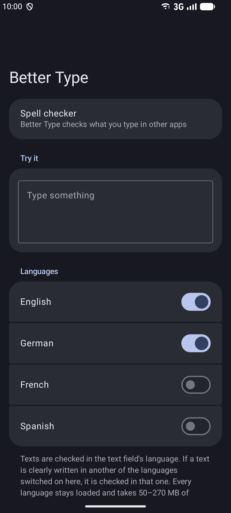
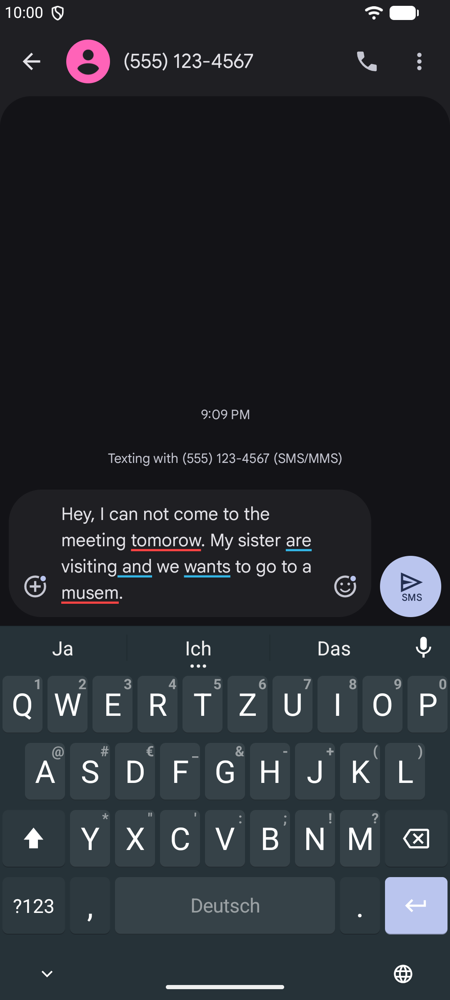

# Better Type

An Android system spell checker that runs [LanguageTool](https://languagetool.org) 6.8 entirely on your device.
Grammar and spelling checks in every text field, no server, no network.

  
  

## Features

- Spelling and grammar checking via Android's spell checker service, so it works in any app
- Runs fully offline, nothing leaves the device
- English, German, French and Spanish
- Choose which languages to load; the text's language is detected automatically
- Keeps loaded languages in memory for fast checks

## Setup

Install the app, then go to Settings → System → Keyboard → Spell checker and choose Better Type.

## Changes to LanguageTool

The LanguageTool 6.8 sources in `lt/` are imported unmodified, except for these prebuilt binary files, which were removed so the app builds from source only (F-Droid's scanner rejects them):

- `lang-de` and `lang-en`: `spelling_correction_model.bin`. A trained XGBoost model that upstream LanguageTool once used to re-rank spelling suggestions. Nothing in LanguageTool 6.8 loads it anymore (no `SuggestionsRanker` implementation, no XGBoost dependency), and it cannot be rebuilt from source.
- `core` tests: the prebuilt Lucene index `yy/ngram-index/` and `LuceneSingleIndexLanguageModelTest`, the only test that read it.

## License

GPL-3.0-or-later. Bundled third-party components are listed in [NOTICE.md](NOTICE.md).
